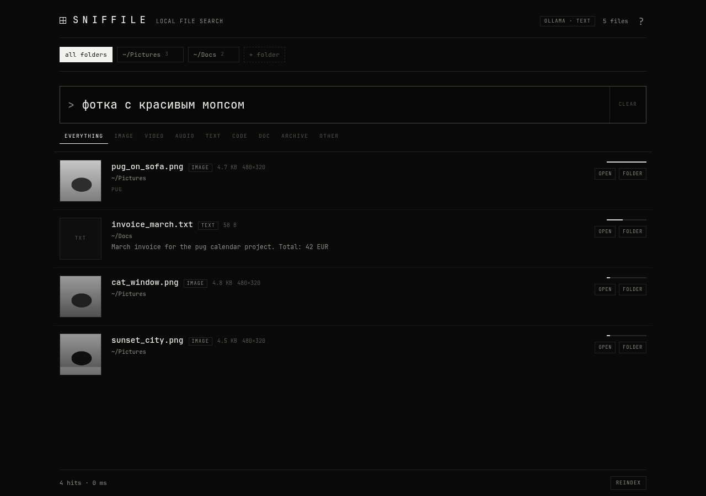

# Sniffile

**Local file search that stays local.** One small Go binary, a black-and-white
interface, and no cloud in the middle.

Type what you remember — `фотка с красивым мопсом`, `invoice march`,
`sunset 2024` — and get the file and the folder it lives in.



## What it does

- Indexes folders you choose, or all of them at once.
- Searches file names, folder names, dates, extensions, image orientation and
  the text inside plain-text/source files.
- Understands Russian and English queries through a small hand-written
  thesaurus (мопс → pug, фотка → photo, машина → car, …).
- Survives typos with a one-edit fuzzy fallback.
- Shows grayscale thumbnails, opens files in your default app, reveals folders.
- Optionally uses a **local** [ollama](https://ollama.com) instance for query
  keywords and for one-line photo captions. Nothing leaves the machine.

Zero Go dependencies. No CGO. No npm. No build step for the UI.

## Install

```sh
go install github.com/kopeyka/sniffile/cmd/sniffile@latest
```

Or from a clone:

```sh
git clone https://github.com/kopeyka/sniffile
cd sniffile
make build          # -> bin/sniffile
```

Requires Go 1.22+.

## Use

```sh
sniffile                          # server on 127.0.0.1:8765, opens the browser
sniffile -addr 127.0.0.1:9000     # another port
sniffile scan ~/Pictures ~/Docs   # index from the terminal, no browser
sniffile scan -describe ~/Pics    # caption photos with ollama (see below)
```

In the UI: `+ folder` adds a scope, the × on a chip removes it, `all folders`
searches everything. `reindex` rebuilds the current scope. Dropdown filters
narrow by file kind.

### Flags

| flag | default | meaning |
|---|---|---|
| `-addr` | `127.0.0.1:8765` | listen address |
| `-data` | `~/.config/sniffile` | config + index folder |
| `-ollama` | `auto` | `auto`, `off`, or a base URL |
| `-open` | `true` | open the browser on start |
| `-max-file-mb` | saved / 64 | skip files bigger than this |
| `-no-content` | `false` | names only, don't read text files |
| `-v` | `false` | log every request |

### Keyboard

`/` search · `j`/`k` or arrows move · `enter` open · `o` open · `r` reveal in
folder · `esc` close.

## How the search works

1. **Walk.** The folder is scanned once. Hidden folders, `.git`, `node_modules`
   and similar junk are skipped. For every file we keep the path, size, date,
   kind and a capped bag of words from names, paths, metadata and (for text
   files) contents.
2. **Rank.** BM25 over an in-memory inverted index. File-name words weigh 3,
   captions 2.5, the rest 1. A whole-query-in-name bonus and a coverage bonus
   keep the obvious answer on top.
3. **Expand.** A small bilingual thesaurus adds English synonyms, so Russian
   queries can hit files named in English. If a query finds literally nothing
   and ollama is running, a local text model is asked for a few English
   keywords and the search is repeated.
4. **Forgive.** Words with no matches at all get a one-edit-distance vocabulary
   pass (`pugg` → `pug`, `кошке` → `кошка`).

There are no embeddings, no vector database, no model download. That is a
deliberate trade: the index builds in seconds and stays inspectable. For
photo *content* search, see the next section.

## Optional: ollama

Sniffile detects a local ollama at `http://127.0.0.1:11434` and uses it only if
it exists.

**Text model** (llama3.2, qwen2.5, mistral, …): translates a dead-end query
into English keywords. Results are cached for ten minutes.

**Vision model** (llava, moondream, …): when you tick `describe photos` before
reindexing, every image gets a one-line caption stored in the index. Captions
are searchable, so `собака на диване` can find `IMG_4821.jpg`.

```sh
ollama pull llava
sniffile scan -describe ~/Pictures
```

No ollama? Everything except content-based photo search still works.

## Where the data lives

```
~/.config/sniffile/config.json      roots, ollama url, limits
~/.config/sniffile/index/*.json.gz  one gzip+json index per root
```

Override the folder with `-data` or `SNIFFILE_DATA`. Delete the `index/` folder
any time; it is a cache.

The only network calls are HTTP requests to your own `127.0.0.1:11434` when
ollama is enabled. There is no telemetry, no update check, no account.

## Honest limits

- Keyword matching, not semantic embeddings. A photo is findable by name or
  caption, not by what a neural net thinks it looks like — unless you add ollama.
- PDF, DOCX, EPUB contents are not parsed. Only plain text and source code.
- EXIF orientation is ignored, so some phone photos may look sideways in the
  preview.
- No OCR. Text inside screenshots is not indexed.
- Files over 64 MB are skipped by default.
- Chinese/Japanese text is tokenized as one long word. Works poorly. PRs welcome.
- One scan job at a time. This is a feature on spinning disks.

## Config file

`config.json` is meant to be readable and editable:

```json
{
  "version": 1,
  "roots": [
    { "path": "/home/you/Pictures", "added_at": "2026-11-14T18:00:00Z",
      "last_scan": "2026-11-14T18:01:12Z", "files": 4211 }
  ],
  "ollama_url": "http://127.0.0.1:11434",
  "max_file_mb": 64
}
```

## Development

```sh
make build     # bin/sniffile
make run       # go run ./cmd/sniffile
make test      # go test ./...
make vet
make fmt
```

Layout:

```
cmd/sniffile      entry point, CLI, flags
internal/index    walker, tokenizer, index format
internal/search   inverted index, BM25, synonyms, fuzzy
internal/enrich   optional ollama client
internal/server   HTTP API + print the manager
web               embedded HTML/CSS/JS
```

Pull requests are welcome; see [CONTRIBUTING.md](CONTRIBUTING.md). Please keep
the dependency count at zero.

## License

MIT. See [LICENSE](LICENSE).

---

[Русская версия](README.ru.md)
