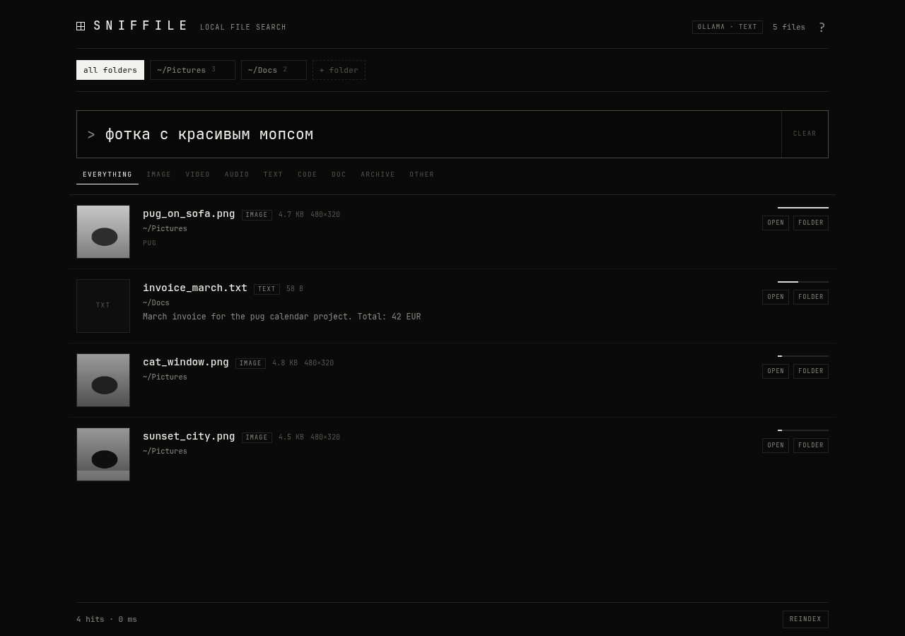

# Sniffile

**Локальный поиск по файлам, который остаётся локальным.** Нативное
приложение — один небольшой бинарник на Go, чёрно-белый интерфейс, без
вкладки браузера и без облака посередине.

Пишешь то, что помнишь — `фотка с красивым мопсом`, `счёт за март`,
`закат 2024` — и получаешь файл и папку, где он лежит.



## Что умеет

- Индексирует выбранные папки или все сразу.
- Ищет по именам файлов и папок, датам, расширениям, ориентации картинок и по
  тексту внутри `txt`/`md`/исходников.
- Понимает русские и английские запросы через маленький рукописный словарь
  (мопс → pug, фотка → photo, машина → car, …).
- Прощает опечатки: одно редактирование расстояния Левенштейна.
- Показывает чёрно-белые превью, открывает файлы в системе, показывает папку.
- Опционально использует **локальную** [ollama](https://ollama.com): ключевые
  слова для запроса и однострочные описания фотографий. Наружу ничего не уходит.

Одна зависимость в Go (`webview_go`) для нативного окна. Без npm, без сборки
JavaScript, без Electron.

## Установка

Нужны GTK 3 и WebKitGTK, всё остальное уже внутри бинарника.

### Arch, Manjaro, EndeavourOS, CachyOS, Garuda

```sh
sudo pacman -S --needed base-devel go gtk3 webkit2gtk-4.1
git clone https://github.com/openastolfo-boop/sniffile
cd sniffile
make build && sudo make install PREFIX=/usr
```

Пакет для pacman: `make arch` (положит `dist/sniffile-*.pkg.tar.zst`).

### Debian 12+, Ubuntu 23.04+, Mint, Pop!_OS, Kali, Raspberry Pi OS

```sh
sudo apt install build-essential pkg-config golang-go libgtk-3-dev libwebkit2gtk-4.1-dev
git clone https://github.com/openastolfo-boop/sniffile
cd sniffile
make build && sudo make install PREFIX=/usr
```

`make deb` соберёт `.deb`, который ставится через
`sudo apt install ./dist/sniffile_*.deb`.

### Ubuntu 22.04, Debian 11 и старше (WebKitGTK 4.0)

Поставь `libwebkit2gtk-4.0-dev` и собери со старым ABI:

```sh
make build-legacy && sudo make install PREFIX=/usr
```

### Fedora, RHEL, Rocky, Alma, openSUSE

```sh
sudo dnf install gcc make pkgconf-pkg-config golang gtk3-devel webkit2gtk4.1-devel
git clone https://github.com/openastolfo-boop/sniffile
cd sniffile
make build && sudo make install PREFIX=/usr
```

`make rpm` соберёт RPM (нужен `rpmbuild` или `nfpm`).

### Alpine

```sh
sudo apk add build-base go pkgconf gtk+3.0-dev webkit2gtk-4.1-dev
make build && sudo make install PREFIX=/usr
```

`make apk` собирает родной `.apk`, но запускать его нужно на Alpine: бинарник
должен быть слинкован с musl, а не glibc.

### Другие Linux

Скачай переносимый tar.gz со страницы релизов, распакуй куда угодно и запусти
`./sniffile`. Из системы нужны только GTK 3 и WebKitGTK 4.1. Для пункта в меню
скопируй `sniffile.desktop` в `~/.local/share/applications/`.

### Windows 10 и 11

Скачай `sniffile-*-windows-amd64-setup.exe` (или переносимый `.zip`) со
страницы релизов. Нужен Microsoft Edge WebView2 — он уже есть в актуальной
Windows 10/11, а установщик предложит официальную загрузку, если его нет.

Сборка через MSYS2:

```sh
pacman -S mingw-w64-x86_64-gcc mingw-w64-x86_64-nsis zip
./scripts/build-windows.sh
```

### macOS

`make build` работает на macOS (Cocoa/WebKit даёт система). Подписанного
`.app` пока нет.

## Как пользоваться

```sh
sniffile                          # нативное окно приложения
sniffile -server                  # та же морда в браузере, если хочется
sniffile scan ~/Pictures ~/Docs   # индексация из терминала, без окна
sniffile scan -describe ~/Pics    # описания фото через ollama (ниже)
```

По умолчанию всегда открывается окно. `-server` нужен только для машин без
графики и для тех, кто сознательно хочет вкладку браузера.

В интерфейсе: `+ folder` добавляет папку, × на чипе убирает её, `all folders`
ищет везде. `reindex` перестраивает текущую область. Фильтры ниже сужают по
типу файла.

### Флаги

| флаг | по умолчанию | значение |
|---|---|---|
| `-server` | `false` | открыть в браузере вместо нативного окна |
| `-addr` | `127.0.0.1:8765` | адрес (окно само выбирает свободный порт) |
| `-data` | `~/.config/sniffile` | конфиг и индексы |
| `-ollama` | `auto` | `auto`, `off` или базовый URL |
| `-open` | `true` | открыть браузер при старте (только режим сервера) |
| `-max-file-mb` | сохранённое / 64 | пропускать файлы больше |
| `-no-content` | `false` | только имена, без чтения текста |
| `-v` | `false` | логировать каждый запрос |

### Клавиши

`/` поиск · `j`/`k` или стрелки — выбор · `enter` открыть · `o` открыть ·
`r` показать в папке · `esc` закрыть.

## Как это ищет

1. **Обход.** Папка сканируется один раз. Скрытые папки, `.git`,
   `node_modules` и подобный мусор пропускаются. Для каждого файла храним путь,
   размер, дату, тип и ограниченный набор слов из имени, пути, метаданных и
   (для текстовых файлов) содержимого.
2. **Ранжирование.** BM25 по инвертированному индексу в памяти. Слова из имени
   файла весят 3, описания 2.5, остальное 1. Бонусы за точное имя и покрытие
   запроса держат очевидный ответ сверху.
3. **Расширение.** Небольшой двуязычный словарь добавляет английские синонимы,
   чтобы русский запрос попадал в файлы с английскими именами. Если запрос не
   нашёл вообще ничего и запущена ollama, локальная текстовая модель выдаёт
   несколько английских ключевых слов и поиск повторяется.
4. **Прощение.** Слова без совпадений проходят проверку по словарю с
   расстоянием в одну правку (`pugg` → `pug`, `кошке` → `кошка`).

Здесь нет эмбеддингов, векторной базы и скачивания моделей. Это осознанный
компромисс: индекс собирается за секунды и его можно открыть руками. Для
поиска по *содержимому* фото — следующий раздел.

## Опционально: ollama

Sniffile сам находит локальную ollama на `http://127.0.0.1:11434` и использует
её, только если она есть.

**Текстовая модель** (llama3.2, qwen2.5, mistral, …) переводит тупиковый запрос
в английские ключевые слова. Результат кешируется на десять минут.

**Vision-модель** (llava, moondream, …): если поставить галочку
`describe photos` перед переиндексацией, каждая картинка получает однострочное
описание, и оно попадает в индекс. Тогда `собака на диване` может найти
`IMG_4821.jpg`.

```sh
ollama pull llava
sniffile scan -describe ~/Pictures
```

Нет ollama? Всё, кроме поиска по содержимому фото, работает.

## Где лежат данные

```
~/.config/sniffile/config.json      папки, url ollama, лимиты
~/.config/sniffile/index/*.json.gz  один gzip+json индекс на папку
```

Папку можно поменять через `-data` или `SNIFFILE_DATA`. Каталог `index/` можно
удалить в любой момент — это кеш.

Единственные сетевые запросы — HTTP к своей же `127.0.0.1:11434`, если включена
ollama. Ни телеметрии, ни проверки обновлений, ни аккаунта.

## Честные ограничения

- Совпадение по словам, а не семантические эмбеддинги. Фото находится по имени
  или описанию, а не по тому, что о нём думает нейросеть, — если не добавить
  ollama.
- Содержимое PDF, DOCX и EPUB не разбирается. Только текст и исходники.
- EXIF-ориентация игнорируется, поэтому некоторые фото с телефона могут быть
  повёрнуты в превью.
- OCR нет. Текст внутри скриншотов не индексируется.
- Файлы больше 64 МБ по умолчанию пропускаются.
- Китайский/японский текст токенизируется как одно длинное слово. Работает
  плохо. PR приветствуются.
- Одновременно идёт только одно сканирование. На HDD это фича.
- На Wayland + NVIDIA отключается DMA-BUF рендерер WebKit: WebKitGTK 2.52 там
  падает. Вернуть можно через `SNIFFILE_DMABUF=1`.

## Конфиг

`config.json` можно читать и править руками:

```json
{
  "version": 1,
  "roots": [
    { "path": "/home/you/Pictures", "added_at": "2026-11-14T18:00:00Z",
      "last_scan": "2026-11-14T18:01:12Z", "files": 4211 }
  ],
  "ollama_url": "http://127.0.0.1:11434",
  "max_file_mb": 64
}
```

## Разработка

```sh
make build     # bin/sniffile
make run       # go run ./cmd/sniffile
make test      # go test ./...
make vet
make fmt
```

Структура:

```
cmd/sniffile      вход, CLI, нативное окно
internal/index    обход, токенизатор, формат индекса
internal/search   инвертированный индекс, BM25, синонимы, нечёткий поиск
internal/enrich   опциональный клиент ollama
internal/server   HTTP API и менеджер
web               встроенные HTML/CSS/JS
packaging/        desktop-файл, иконки, Arch/RPM/Windows/deb
scripts/          сборка deb, rpm, apk, Arch и Windows пакетов
debian/           исходная сборка через debhelper
```

Пакеты:

```sh
make dist      # переносимый tar.gz
make deb       # Debian/Ubuntu (debhelper не нужен)
make rpm       # Fedora/openSUSE (rpmbuild или nfpm)
make apk       # Alpine (nfpm)
make arch      # Arch через makepkg
make windows   # .exe, zip и установщик NSIS
```

PR приветствуются, см. [CONTRIBUTING.md](CONTRIBUTING.md). Пожалуйста, не
раздувайте список зависимостей.

## Лицензия

MIT. См. [LICENSE](LICENSE).

---

[English version](README.md)
